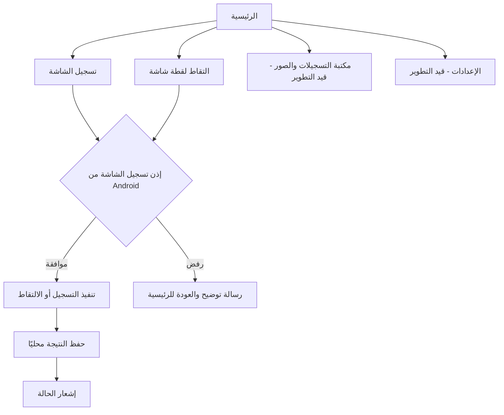
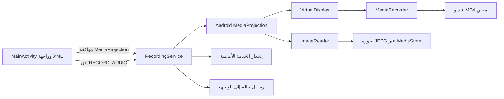

# خريطة تطبيق Shbeeb Capture

> هذه الوثيقة تصف بنية التطبيق وتدفق الاستخدام، وتفصل بوضوح بين ما يعمل في النموذج الحالي وما هو مخطط للتطوير. المستودع هو المرجع المعتمد لحالة التنفيذ.

## 1. خريطة الشاشات

### الرئيسية
- اختيار تسجيل فيديو للشاشة أو التقاط صورة للشاشة.
- اختيار مصدر صوت من عناصر الواجهة؛ دعم النظام الصوتي الداخلي غير مكتمل حاليًا.
- خيار إظهار أثر اللمس ظاهر في الواجهة، لكن رسم المؤشرات فوق التسجيل غير منفّذ بعد.
- بدء التسجيل وإيقافه مع حالة نصية أساسية.

### التسجيل
- يطلب التطبيق موافقة Android على تسجيل الشاشة قبل كل جلسة.
- عند التسجيل بالميكروفون يطلب إذن الصوت عند الحاجة.
- يستخدم التطبيق خدمة أمامية لتشغيل الالتقاط وإظهار إشعار أثناء عملها.
- يحفظ فيديو MP4 في مجلد التطبيق ضمن مجلد Movies.

### لقطة الشاشة
- يطلب موافقة تسجيل الشاشة من النظام.
- يحفظ صورة JPEG في `Pictures/Shbeeb Capture`.

### المكتبة والإعدادات
لم تُبنَ بعد. التسجيلات تحفظ محليًا، لكن لا توجد حاليًا شاشة مكتبة داخل التطبيق أو أدوات إدارة/تحرير.

## 2. مخطط معماري مبسط

### وحدات المشروع
| المسار | المسؤولية |
|---|---|
| `app/src/main/java/com/shbeeb/capture/MainActivity.kt` | واجهة البداية، الأذونات، وطلب موافقة التقاط الشاشة |
| `app/src/main/java/com/shbeeb/capture/RecordingService.kt` | تسجيل الشاشة، الالتقاط الثابت، حفظ الملفات والإشعارات |
| `app/src/main/res/layout/activity_main.xml` | تخطيط الواجهة العربية الحالية |
| `app/src/main/AndroidManifest.xml` | تعريف الأذونات والنشاط والخدمة الأمامية |
| `.github/workflows/android.yml` | بناء APK تجريبي تلقائيًا على GitHub Actions |

## 3. حالة الميزات

| الميزة | الحالة الحالية |
|---|---|
| تسجيل الشاشة إلى MP4 | نموذج أولي قابل للبناء؛ يحتاج اختبار أجهزة فعليًا |
| لقطة شاشة JPEG | مسار الالتقاط موجود؛ يحتاج اختبارًا على الجهاز |
| تسجيل صوت الميكروفون | خيار أولي؛ يتطلب الإذن |
| صوت النظام أو دمج النظام والميكروفون | غير منفذ بعد؛ يختلف دعمه حسب إصدار Android والتطبيقات |
| دقة/إطارات/ترميز قابلة للاختيار | غير منفذة؛ الإعدادات ثابتة حاليًا |
| مؤشرات اللمس | خيار واجهة فقط حاليًا؛ يحتاج تنفيذ طبقة تراكب مناسبة |
| معاينة، مكتبة، قص ومشاركة | غير منفذة بعد |
| بناء APK | GitHub Actions ينتج APK Debug كمخرج قابل للتنزيل |

## 4. أولويات التطوير المقترحة

1. اختبار التسجيل واللقطات على الهاتف المستهدف وإصلاح دورة بدء/إيقاف الخدمة وحالات الرفض.
2. إضافة حفظ ظاهر في المعرض للفيديو، ورسائل أخطاء وإيقاف أكثر موثوقية.
3. تنفيذ مكتبة محلية بسيطة لمعاينة الملفات ومشاركتها وحذفها.
4. إضافة إعدادات الجودة المدعومة فعليًا من الجهاز، مع قيم افتراضية خفيفة.
5. تنفيذ مؤشرات اللمس بشكل صريح ومتوافق مع أذونات Android، ثم اختبارها أثناء تسجيل تطبيقات أخرى.
6. دراسة التقاط صوت النظام باستخدام واجهات Android المدعومة، مع إظهار عدم التوافق عند تعذره بدل الادعاء بأنه يعمل.

## 5. قيود المنصة

Android يطلب موافقة المستخدم عبر واجهة النظام لالتقاط الشاشة. التقاط صوت النظام له متطلبات توافق وسياسات خاصة، ولا يمكن ضمانه لكل التطبيقات أو الأجهزة. إبقاء التسجيل محليًا هو السلوك الحالي؛ لا توجد مزامنة سحابية أو إرسال تلقائي.